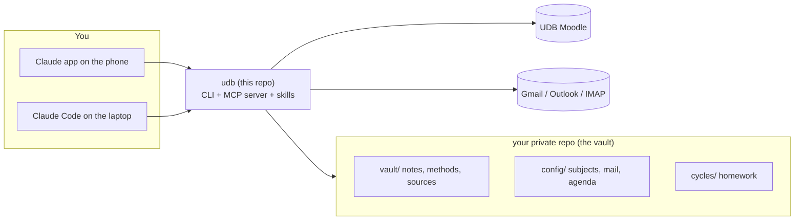

# udb-copilot

A study copilot for **Universidad Don Bosco** students, built for
[Claude Code](https://claude.com/claude-code). It reads your virtual classroom
(Moodle), your mail and your course material, and keeps a study vault where
every claim is cited and every exercise follows your teacher's method.

> **En español:** un copiloto de estudio para la UDB. Lee tu aula virtual, tu
> correo y el material de clase; escribe apuntes con citas verificables y resuelve
> ejercicios con el método del profesor. Te manda cada mañana un resumen con
> lo que vence y cuántos días faltan para cada evaluación. Todo funciona
> desde el teléfono con Claude Code en la nube. El
> [inicio rápido](#quickstart) son 10 minutos.

## What it does

| | |
|---|---|
| **Morning briefing** | Every day at 06:00: classes today, days left to every evaluation, what is due in 72 hours, new classroom activity and teacher mail. |
| **Change alerts** | An email only when a teacher publishes or edits an assignment, posts an announcement or writes to you. |
| **Ask from your phone** | "What's pending in IRD?", "Explain class 3 of AVM" — in a Claude Code cloud session. |
| **Cited notes** | Class and concept notes in plain Spanish; every claim carries an anchor to the exact page or minute of the source, checked without a model. |
| **The teacher's method** | Exercises are solved only with the procedure the teacher taught, step by step, as HTML cards with formulas rendered offline. |
| **Status board** | One row per class: material, recording, explanation, method, exercises, lesson, citation errors, next step. |
| **Many mail accounts** | Gmail, Outlook (university or personal) and any IMAP server, declared in one file. |
| **Reads everything** | Scanned PDFs get OCR; the images of the course pages are downloaded and read; HTML pages are split by section, so a citation points at "Inverso multiplicativo", not at a 20-page site. `udb sources` says what is still missing. |
| **Inline views** | Pending work, class status, agenda and tasks show up as a small view inside the Claude chat, built from real data. |
| **Never skips the classroom** | Any question about tasks, exams or deadlines gets the real Moodle state injected before Claude answers. |
| **Homework and projects** | One folder per assignment, joined with Moodle; project code stays in its own repos, linked from the task. |

## How it fits together



Two repositories, on purpose:

- **This repo (public)** is the engine: the `udb` command, the MCP server Claude
  uses, the skills, agents and safety hooks.
- **Your vault (private)** is your data: course material, notes, homework,
  config. It is a separate private GitHub repo so a cloud session can clone it.
  Course material is copyrighted and your mail is yours: never make it public.

## Quickstart

You need Python 3.11–3.13, [uv](https://docs.astral.sh/uv/), git, and
[Claude Code](https://claude.com/claude-code). Node.js is needed to render
formulas.

```bash
uv tool install "udb-copilot[ocr,outlook,agent] @ git+https://github.com/franc1sc0sv/udb-copilot"
udb init ~/udb-vault          # creates the data home and wires Claude Code into it
cd ~/udb-vault
udb setup                     # Moodle login, pick your courses, add mail accounts
udb sync IRD                  # downloads and indexes the material of one subject
udb sources fix IRD           # OCR for scanned PDFs, reads the figures of the course pages
udb status                    # the board of every class
```

Then open Claude Code in that folder and ask: *"¿Qué tengo pendiente?"*

Make the vault a private GitHub repo to use it from your phone:

```bash
git init && git add -A && git commit -m "My vault"
gh repo create udb-vault --private --source . --push
```

## Daily briefing and phone access

1. In [claude.ai/code](https://claude.ai/code), create a cloud environment for
   your vault repo (see [docs/cloud.md](docs/cloud.md) for the network allowlist,
   the environment variables and the setup script).
2. Ask Claude in that environment: *"Create a routine that runs every day at 05:52
   and emails me the udb digest"*. The prompt to use is in
   [docs/cloud.md](docs/cloud.md#routines).
3. From the Claude app on your phone, open a session on the vault repo and ask
   anything. The skills (`/udb-digest`, `/udb-status`, `/udb-agenda`...) load by
   themselves.

## Mail accounts

The easy way: `udb mail add`. It asks the type, the address and the password, tests the
connection and saves it. For Gmail it uses an app password (Google account → Security →
App passwords), no Google Cloud project needed.

`config/mail.yaml` lists as many accounts as you want:

```yaml
accounts:
  - id: personal
    provider: gmail
    auth: app-password      # or OAuth (omit this line) to also read Calendar and Drive
    address: you@gmail.com
    send: true              # can send you the daily summary
  - id: udb
    provider: outlook       # Microsoft Graph; see docs/outlook.md
    address: you@udb.edu.sv
    tenant: organizations
    client_id: <your app registration>
  - id: other
    provider: imap          # any IMAP server with an app password
    host: imap.example.com
    address: you@example.com
filters:
  - name: teachers
    from_domains: [udb.edu.sv]
```

Then `udb mail login <id>` once per account. Credentials live in
`~/.config/udb/` (mode 600), never in the repo. In cloud sessions an account reads
them from the variable named in `credentials_env`.

## Commands

| Area | Commands |
|---|---|
| Setup | `udb init`, `udb setup`, `udb setup claude`, `udb setup mathjax`, `udb migrate` |
| Sources | `udb sources`, `udb sources fix`, `udb verify --fix` |
| Views | `udb view digest/status/agenda/tasks` (what Claude shows inline) |
| Classroom | `udb moodle login/courses`, `udb sync`, `udb assignments`, `udb assignment fetch/submission` |
| Planning | `udb digest`, `udb agenda`, `udb status`, `udb tasks`, `udb task new`, `udb projects` |
| Vault | `udb ingest`, `udb reindex`, `udb verify`, `udb coverage`, `udb figures`, `udb diagrams` |
| Writing (with Claude) | `udb class new/write/lesson`, `udb method new/extract/list`, `udb note new`, `udb exercise`, `udb study`, `udb explain`, `udb ask` |
| Mail and Drive | `udb mail add/accounts/login/search/attachments`, `udb drive upload/replace/download/trash` |
| Recordings (local) | `udb recording discover/board/download/attach/transcribe/frames/radar/process` |

Run `udb <command> --help` for the details.

## The rules Claude follows

1. **The teacher's method is the law.** No method, no solution.
2. **Never invent a citation.** Sources are only read through `vault_search` and
   `vault_quote`; a hook blocks opening them directly.
3. **Plain Spanish.** Short sentences, active voice, real-number examples.
4. **One diagram per note.**
5. **Exercises are HTML step cards** with formulas rendered to SVG.

`udb verify` checks all of this without a model; [docs/references.md](docs/references.md)
explains how a citation is made and checked. The write hook runs the same
checks on every file Claude writes and makes it fix the errors.

## Privacy and security

- Your UDB password is used once to get a Moodle token and is never stored.
- Tokens and mail credentials stay outside the repo with mode 600.
- A hook blocks reading secret files, opening course sources directly, and
  reaching the classroom with a browser or `curl`. The hook fails closed: if
  `udb` is missing, the tool call is blocked.
- The Moodle token can do everything your account can; the tools only read.
  Rotate it each term (Moodle → Preferences → Security keys).

## Data layout

```
udb.yaml                          marks the data home (institution, timezone, language)
config/subjects.yaml              your subjects, Moodle course ids, class days
config/mail.yaml                  mail accounts and filters
config/agenda.yaml                graded activities from each learning route
vault/<CODE>/sources/             course files (never opened directly)
vault/<CODE>/derived/             extracted text and transcripts (never opened directly)
vault/<CODE>/classes/NN-date/     class.md · assignment.md · lesson.html
vault/<CODE>/{concepts,methods,exercises}/
cycles/<term>/<CODE>/tasks/<NN-slug>/   TASK.md · delivery/ · work/
index/                            generated: search index, boards (not committed)
```

## Optional extras

| Extra | For |
|---|---|
| `outlook` | Outlook / Microsoft 365 mail (msal) |
| `agent` | `udb class write`, `udb study` and other commands that run Claude from the terminal |
| `asr` | Transcribing class recordings on an NVIDIA GPU (CUDA 12.8+) |
| `ocr` | Reading the text on recording frames |

## Development

```bash
git clone https://github.com/franc1sc0sv/udb-copilot && cd udb-copilot
uv sync --extra dev
uv run ruff check src
```

There is no test suite: changes are checked by running `udb` against a real vault.
Architecture notes are in [docs/architecture.md](docs/architecture.md).

## License

MIT. Course material you download stays under its own copyright: keep your vault private.
